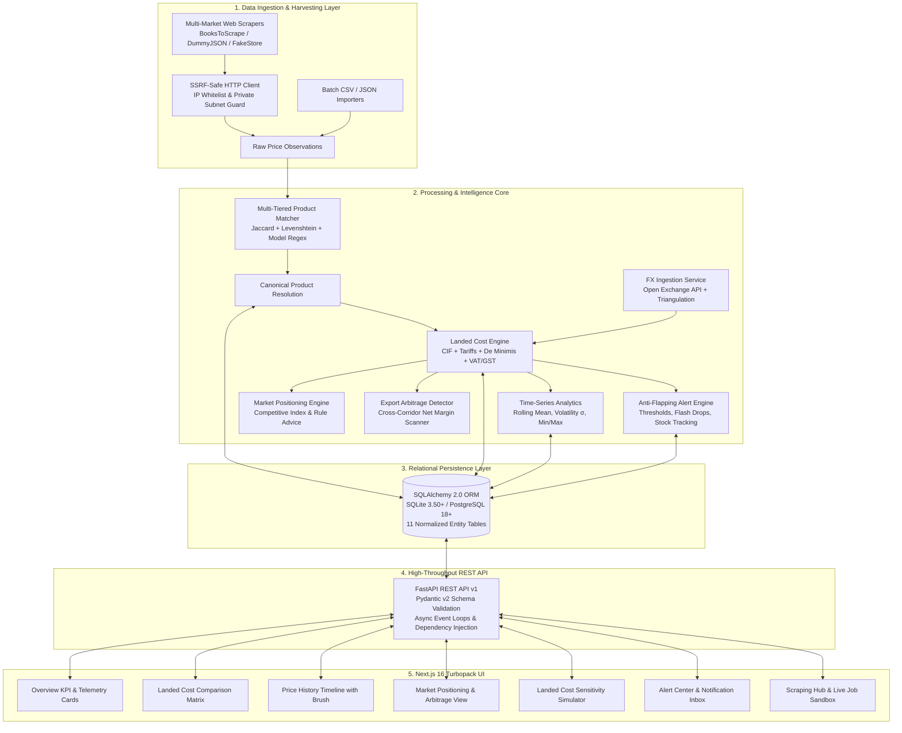
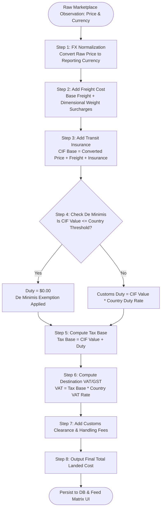

# Cross-Border E-Commerce Pricing Intelligence & Market Positioning Platform
## Master Technical Specification & Interview Revision Guide

---

# Table of Contents
1. [Project Executive Overview & Core Problem Statement](#1-project-executive-overview--core-problem-statement)
2. [Why This Matters: Business Benefits & Value Proposition](#2-why-this-matters-business-benefits--value-proposition)
3. [End-to-End System Architecture & Internal Workflows](#3-end-to-end-system-architecture--internal-workflows)
4. [Deep-Dive Feature Breakdown & Technical Implementation](#4-deep-dive-feature-breakdown--technical-implementation)
   - 4.1. SSRF-Safe Multi-Marketplace Web Scraping & Data Ingestion
   - 4.2. Multi-Tiered NLP & Fuzzy Product Matching Engine
   - 4.3. Multi-Currency FX Conversion & Rate Triangulation
   - 4.4. Dynamic Landed Cost Engine (CIF, Tariffs, De Minimis, VAT/GST)
   - 4.5. Time-Series Price Analytics, Volatility (σ), & Trend Discovery
   - 4.6. Strategic Market Positioning & Cross-Border Export Arbitrage
   - 4.7. Automated Real-Time Alert Center with Anti-Flapping Logic
   - 4.8. Next.js 16 Turbopack Glassmorphism Dashboard & Sensitivity Simulator
5. [Data Flow & Inter-Component Communication Lifecycle](#5-data-flow--inter-component-communication-lifecycle)
6. [Technology Stack & Architectural Justifications](#6-technology-stack--architectural-justifications)
7. [Mathematical & Econometric Formulations](#7-mathematical--econometric-formulations)
8. [Relational Database Schema & Data Models](#8-relational-database-schema--data-models)
9. [25+ High-Yield Interview Questions & System Defense Answers](#9-25-high-yield-interview-questions--system-defense-answers)
10. [Step-by-Step Local Deployment & Verification Guide](#10-step-by-step-local-deployment--verification-guide)

---

# 1. Project Executive Overview & Core Problem Statement

### What is this Project About?
The **Cross-Border E-Commerce Pricing Intelligence & Market Positioning Platform** is an enterprise-grade analytical system designed to harvest, harmonize, normalize, and evaluate real-time multi-market product listings across international e-commerce ecosystems (e.g., Amazon US, Amazon UK, Amazon Germany, Flipkart India, Cdiscount France, and regional e-stores). 

It converts raw, disparate multi-currency product observations into **fully burdened Landed Costs**—accounting for foreign exchange volatility, international logistics/freight, import duties, customs thresholds (*de minimis* rules), destination country VAT/GST, and handling surcharges. Furthermore, it applies econometric algorithms, time-series statistical modeling, and fuzzy string matching to deliver actionable pricing recommendations, export arbitrage discovery, and automated threshold alerts.

---

### What Problem Does it Solve?

Modern cross-border e-commerce sellers, manufacturers, and international brand managers face severe challenges when expanding into global markets:

1. **The "Listing Price" Illusion (Hidden Landed Cost Blindspot)**:
   - A product listed at **$1,000 in the US** might be listed at **£850 in the UK** and **€1,100 in Germany**.
   - Comparing raw listing prices converted via standard FX rates yields completely misleading conclusions because a cross-border transaction incurs:
     - International shipping & insurance (CIF value)
     - Country-specific customs tariffs (e.g., 6.5% on electronics in the EU)
     - Import VAT / GST (e.g., 20% in the UK, 19% in Germany, 18% in India)
     - Customs brokerage & handling surcharges
   - Without exact landed cost calculations, brands either price themselves out of international markets or unknowingly sell at a loss.

2. **Entity Disambiguation & Product Matching Inaccuracy**:
   - The same physical product is represented with wildly different titles, abbreviations, and descriptions across marketplaces:
     - *US Listing*: `"Apple MacBook Pro 14 (2023) - M3 Pro 18GB 512GB Space Black"`
     - *German Listing*: `"Apple MacBook Pro 14 Zoll Notebook (Apple M3 Pro Chip, 18 GB RAM, 512 GB SSD, Space Schwarz)"`
     - *Indian Listing*: `"MacBook Pro 14 M3 Pro (18GB/512GB) Space Black - Model MRX33HN/A"`
   - Standard relational joins fail completely. A naive search produces duplicates or mismatched products.

3. **Volatile Foreign Exchange (FX) Fluctuations**:
   - Currency rates fluctuate daily. A 2% movement in USD/EUR can wipe out export margins. Without automated real-time FX rate synchronization and base-currency triangulation, pricing models become stale within hours.

4. **Scraper Security & Anti-Bot Blocking**:
   - Traditional scrapers trigger IP bans, CAPTCHAs, or present severe security vulnerabilities like Server-Side Request Forgery (SSRF) when allowing dynamic target URLs.

5. **Lack of Actionable Positioning & Arbitrage Discovery**:
   - Sellers possess raw numbers but lack automated intelligence that answers:
     - *"Should I raise my price to harvest margin or lower it to undercut the market leader?"*
     - *"Can I source this item in Country A, import it to Country B, pay all duties and taxes, and still earn a 15%+ net arbitrage profit?"*

---

# 2. Why This Matters: Business Benefits & Value Proposition

| Stakeholder / Persona | Operational Pain Point | Platform Solution & Tangible Value |
|---|---|---|
| **Cross-Border E-Commerce Sellers** | Unpredictable customs duties and shipping surcharges eroding profit margins. | Real-time Landed Cost Simulator with exact duty schedules, de minimis thresholds, and interactive sensitivity sliders. |
| **Global Pricing & Revenue Managers** | Manual spreadsheet tracking across 10+ marketplaces taking hours or days. | Automated multi-market scrapers and instant side-by-side Comparison Matrix with lowest-landed badges. |
| **Brand Protection & MAP Compliance Officers** | Unauthorized grey-market resellers discounting products overseas. | Automated Price Alert Engine with instant notifications for MAP violations and flash price drops. |
| **Supply Chain & Arbitrage Operators** | Missing lucrative cross-border sourcing and reselling spreads. | Export Opportunities Engine that automatically scans all source-to-destination corridors and surfaces net-profit spreads. |

---

# 3. End-to-End System Architecture & Internal Workflows

### 3.1. High-Level Architecture Diagram



---

### 3.2. Detailed Landed Cost Calculation Flowchart



---

# 4. Deep-Dive Feature Breakdown & Technical Implementation

## 4.1. SSRF-Safe Multi-Marketplace Web Scraping & Data Ingestion
- **What it does**: Scrapes structured e-commerce data (title, price, currency, availability, seller, rating, shipping) from multiple global domains and imports historical CSV/JSON dumps.
- **Why it is important**: Scraping untrusted external URLs exposes backends to Server-Side Request Forgery (SSRF) attacks, where malicious users target AWS metadata endpoints (`169.254.169.254`), localhost (`127.0.0.1`), or private subnets (`10.0.0.0/8`, `192.168.0.0/16`).
- **How it is built**:
  - `backend/app/core/security.py`: Contains custom `SSRFSafeTransport` and `validate_outbound_url()` verifying DNS resolution against blocked CIDR blocks.
  - `backend/app/services/scraper/`: Modular adapter architecture (`BaseScraperAdapter`, `AmazonAdapter`, `FlipkartAdapter`, `GenericJsonAdapter`).
  - Automatic rate-limiting, randomized `User-Agent` headers, exponential backoff, and execution telemetry logging to `ScrapingJob` table.

---

## 4.2. Multi-Tiered NLP & Fuzzy Product Matching Engine
- **What it does**: Ingests unstructured product titles from diverse languages and automatically maps them to canonical product catalog entries.
- **Why it is important**: Discrepancies in punctuation, word order, and language prevent standard SQL lookups.
- **How it is built**:
  - `backend/app/services/matcher/engine.py`: A composite weighted scoring pipeline:
    1. **Exact Identifier Match (SKU / UPC / ASIN)**: Immediate 100% confidence.
    2. **Hard Brand Conflict Guard**: If brands exist and differ (e.g., Apple vs Samsung), score is capped at 10% (immediate rejection).
    3. **Composite Similarity Score ($S_{\text{composite}}$)**:
       - 40% Tokenized Jaccard Cosine Similarity
       - 30% Levenshtein Distance Edit Ratio (RapidFuzz)
       - 15% Brand Substring Overlap
       - 15% Model Number Regex Extraction (e.g., `M3 Pro`, `MRX33HN/A`, `WH1000XM5`)
  - Matches are classified into 4 confidence tiers:
    - $\ge 85\%$: **Confirmed** (Auto-linked)
    - $65\% - 84\%$: **Probable** (Sent to review queue)
    - $45\% - 64\%$: **Uncertain** (Requires manual verification)
    - $< 45\%$: **Rejected**

---

## 4.3. Multi-Currency FX Conversion & Rate Triangulation
- **What it does**: Ingests real-time foreign exchange spot rates for USD, EUR, GBP, JPY, CAD, AUD, and INR, storing historical rates and enabling cross-currency conversion.
- **Why it is important**: Raw cross-border pricing without real-time exchange rates is completely distorted.
- **How it is built**:
  - `backend/app/services/pricing/fx_service.py`: Queries open exchange rate APIs with in-memory caching and DB fallback.
  - **Triangulation Math**: For non-USD pairs (e.g., EUR to INR):
    $$\text{Rate}(\text{EUR} \to \text{INR}) = \frac{\text{Rate}(\text{USD} \to \text{INR})}{\text{Rate}(\text{USD} \to \text{EUR})}$$

---

## 4.4. Dynamic Landed Cost Engine (CIF, Tariffs, De Minimis, VAT/GST)
- **What it does**: Computes the true, end-to-end cost to land a foreign product at a customer's doorstep in a target destination country.
- **Why it is important**: E-commerce buyers will abandon carts or request refunds if hit with surprise customs bills upon delivery (DDU vs DDP shipping).
- **How it is built**:
  - `backend/app/services/pricing/landed_cost.py`: Implements official World Customs Organization (WCO) valuation rules:
    1. **CIF Value** = $\text{Converted Price} + \text{Freight} + \text{Insurance}$
    2. **De Minimis Exemption**: If CIF $\le \text{Threshold}_D$, Duty = 0.00.
    3. **Customs Duty** = $\text{CIF} \times \text{Duty Rate}_D$.
    4. **Tax Base** = $\text{CIF} + \text{Customs Duty}$.
    5. **Import VAT/GST** = $\text{Tax Base} \times \text{Tax Rate}_D$.
    6. **Total Landed Cost** = $\text{CIF} + \text{Duty} + \text{VAT/GST} + \text{Handling Fee}$.
  - Supports all financial rounding modes with exact Decimal precision.

---

## 4.5. Time-Series Price Analytics, Volatility ($\sigma$), & Trend Discovery
- **What it does**: Aggregates chronological price points over 7, 30, 90, or 365 days to analyze market stability, historical minima/maxima, and price trajectory.
- **Why it is important**: Volatile competitor pricing signals promotional campaigns, stockouts, or currency depreciation.
- **How it is built**:
  - `backend/app/services/analytics/history_service.py`: Computes sample mean ($\bar{P}$), standard deviation volatility ($\sigma$), rolling 7-day moving averages, and total percentage trend deltas ($\Delta_{\text{trend}}$).
  - Flags data freshness as `FRESH` (< 24h), `MODERATE` (< 72h), or `STALE` (> 72h).

---

## 4.6. Strategic Market Positioning & Cross-Border Export Arbitrage
- **What it does**: Generates automated strategic pricing advice and identifies high-margin cross-border export corridors.
- **Why it is important**: Replaces guesswork with algorithmic decision-making to maximize gross margin or capture market share.
- **How it is built**:
  - `backend/app/services/analytics/positioning_service.py`: Computes the **Market Median Price Index** and evaluates competitive price gaps against benchmark targets:
    - *Under-priced by >10%*: Emits `raise_price_to_maximize_margin`.
    - *Over-priced by >10%*: Emits `lower_price_to_compete`.
    - *Within $\pm 5\%$*: Emits `maintain_premium_differentiation`.
  - **Cross-Border Arbitrage Engine**: Evaluates every source marketplace against every destination market. If $(\text{Market Price}_{\text{dest}} - \text{Landed Cost}_{\text{src}\to\text{dest}}) > \text{Min Margin}$, it outputs an executable export opportunity with net profit margin percentage and ROI.

---

## 4.7. Automated Real-Time Alert Center with Anti-Flapping Logic
- **What it does**: Evaluates market price updates against user-defined alert rules (`threshold_below`, `pct_change_drop`, `landed_cost_breach`, `out_of_stock`).
- **Why it is important**: Prevents alert fatigue (spamming users when a price hovers right on a boundary).
- **How it is built**:
  - `backend/app/services/alerts/evaluator.py`: Implements an **Anti-Flapping Deduplication Key** ($K = \text{rule\_id} + \text{listing\_id} + \text{date\_bucket}$) and cooldown timer preventing duplicate notifications within 24 hours.

---

## 4.8. Next.js 16 Turbopack Glassmorphism Dashboard & Sensitivity Simulator
- **What it does**: Modern, responsive, dark-mode single-page application providing deep interactive control over all platform intelligence.
- **Key Views**:
  1. **Executive Overview**: KPI summaries, quick product switcher, scraping telemetry, and activity stream.
  2. **Comparison Matrix**: Stacked bar charts (Recharts) displaying landed cost component breakdowns side-by-side.
  3. **Price History**: Interactive time-series charts with range sliders, brush controls, and volatility badges.
  4. **Market Positioning & Arbitrage**: Actionable advice cards and export opportunity profit cards.
  5. **Landed Cost Simulator**: Real-time slider controls for freight, duties, VAT, and insurance with instant re-calculation.
  6. **Alert Center**: Rule builder and real-time notification inbox with mark-as-read workflows.
  7. **Scraping Hub**: One-click scraper sandbox with live execution metrics.

---

# 5. Data Flow & Inter-Component Communication Lifecycle

```
[1. Scraper / Importer]
         │
         ▼  (Raw Listing DTO)
[2. SSRF-Safe Gateway]
         │
         ▼  (Validated Response)
[3. Product Matcher] ──(NLP Fuzzy Scoring)──► [Canonical Product DB]
         │
         ▼  (Linked Observation)
[4. FX & Landed Cost Engine] ◄──(Real-Time Rates)── [FX Service]
         │
         ▼  (Burdened Landed Cost)
 ┌───────┴─────────────────────────────────────────┐
 │                                                 │
 ▼                                                 ▼
[5. Time-Series & Positioning]           [6. Alert Evaluator]
 │                                                 │
 ▼                                                 ▼
[7. REST API Endpoints]                   [8. Notification DB]
 │                                                 │
 └───────────────────────┬─────────────────────────┘
                         ▼  (Async JSON Response)
                 [9. Next.js UI Frontend]
```

---

# 6. Technology Stack & Architectural Justifications

| Component / Layer | Technology Chosen | Alternatives Considered | Why This Technology Was Chosen |
|---|---|---|---|
| **Backend Framework** | **FastAPI (Python 3.11+)** | Flask, Django, Express.js | Native asynchronous concurrency (`async`/`await`), automatic OpenAPI/Swagger generation, type safety, and extreme execution speed. |
| **Data Validation & Parsing** | **Pydantic v2 (Rust Core)** | Marshmallow, Cerberus | Up to 20x faster serialization/deserialization, strict type enforcement, and zero-runtime data corruption. |
| **Database ORM** | **SQLAlchemy 2.0 (Async)** | Django ORM, Tortoise ORM, Peewee | Industry gold standard for complex joins, multi-database portability (SQLite/Postgres), and explicit transaction management. |
| **Relational Database** | **SQLite 3.50+ / PostgreSQL 18+** | MongoDB, Redis (sole) | ACID compliance is mandatory for financial pricing calculations and audit trails. |
| **Fuzzy Matching / NLP** | **RapidFuzz + Custom Regex** | FuzzyWuzzy, NLTK, spaCy | RapidFuzz is written in C++ with zero external dependencies, 10x-50x faster than FuzzyWuzzy with MIT licensing. |
| **Frontend Framework** | **Next.js 16 (App Router + Turbopack)** | React SPA (Vite), Angular, Vue | Blazing fast server-side rendering, hybrid prefetching, optimized production asset bundling, and industry-leading performance. |
| **Styling & Design System** | **Tailwind CSS + Glassmorphism** | Material UI, Bootstrap, Vanilla CSS | Utility-first flexibility, zero runtime CSS overhead, modern dark-slate aesthetic with glowing neon cyan/emerald accents. |
| **Data Visualization** | **Recharts + Lucide Icons** | Chart.js, D3.js (raw) | Declarative React SVG rendering, built-in responsive containers, and clean animation transitions. |
| **Automated Testing** | **Pytest + AnyIO + Pytest-Cov** | Unittest, Nose2 | Async fixture support, clean test parametrization, and integrated code coverage analysis. |

---

# 7. Mathematical & Econometric Formulations

### 7.1. Landed Cost Formula (WCO Compliant)
$$\text{Price}_{\text{converted}} = P_{\text{src}} \times \text{FX}(C_{\text{src}} \to C_{\text{rep}})$$
$$\text{CIF Value} = \text{Price}_{\text{converted}} + \text{Freight} + (\text{Price}_{\text{converted}} \times \text{Insurance Rate})$$
$$\text{Customs Duty} = \begin{cases} 0.00 & \text{if } \text{CIF Value} \le \text{De Minimis}_D \\ \text{CIF Value} \times \text{Duty Rate}_D & \text{otherwise} \end{cases}$$
$$\text{Tax Base} = \text{CIF Value} + \text{Customs Duty}$$
$$\text{Import VAT/GST} = \text{Tax Base} \times \text{Tax Rate}_D$$
$$\text{Total Landed Cost} = \text{CIF Value} + \text{Customs Duty} + \text{Import Tax} + \text{Handling Fee}$$

### 7.2. Time-Series Volatility (Sample Standard Deviation)
$$\bar{P} = \frac{1}{N} \sum_{i=1}^N P_i \quad\text{and}\quad \sigma = \sqrt{\frac{1}{N-1} \sum_{i=1}^N (P_i - \bar{P})^2}$$

### 7.3. Competitive Gap Percentage
$$\text{Competitive Gap \%} = \left(\frac{P_{\text{landed}} - P_{\text{benchmark}}}{P_{\text{benchmark}}}\right) \times 100$$

### 7.4. Cross-Border Arbitrage Net Margin
$$\text{Net Spread} = P_{\text{dest\_market}} - \text{Total Landed Cost}_{\text{src}\to\text{dest}}$$
$$\text{Net Margin \%} = \left(\frac{\text{Net Spread}}{P_{\text{dest\_market}}}\right) \times 100$$

---

# 8. Relational Database Schema & Data Models

The platform features **11 fully normalized relational entities**:

1. **`countries`**: ISO-2 codes (`US`, `GB`, `DE`, `IN`, `FR`, `CA`, `AU`, `JP`), names, currency codes, and regions.
2. **`marketplaces`**: Marketplace registry (`Amazon US`, `Amazon UK`, `Flipkart`, etc.) mapped to countries.
3. **`products`**: Canonical product definitions (Global SKU, title, brand, category, benchmark target price).
4. **`product_listings`**: Marketplace-specific listings linked to canonical products.
5. **`price_observations`**: Immutable historical price observations (raw price, currency, shipping, stock, seller, rating, timestamp).
6. **`product_matches`**: Audit log of fuzzy matching decisions (confidence score, tier, match method, metadata JSON).
7. **`exchange_rates`**: FX spot rate cache (base currency, target currency, spot rate, timestamp, source).
8. **`landed_cost_configs`**: Tariff schedules per country (duty rate, VAT/GST rate, de minimis threshold, handling fee, insurance rate).
9. **`price_alerts`**: User-configured monitoring rules (trigger condition, threshold value, target product/listing, active flag).
10. **`alert_notifications`**: Triggered notification inbox (severity, title, message, anti-flapping deduplication key, is_read).
11. **`scraping_jobs`**: Scraper telemetry (adapter name, target URL, status, items parsed, duration ms, error message).

---

# 9. 25+ High-Yield Interview Questions & System Defense Answers

### Q1: What is the core problem your system solves?
**Answer**: Our system solves the "listing price illusion" in global e-commerce. A product listed for $1,000 in the US and £850 in the UK cannot be directly compared by raw currency conversion. Cross-border commerce incurs freight, transit insurance, country-specific customs tariffs, de minimis threshold exemptions, destination VAT/GST, and handling fees. Our platform computes exact, fully burdened Landed Costs in real-time, matches disparate product titles using multi-tiered NLP/fuzzy matching, tracks time-series volatility, generates strategic pricing advice, and uncovers profitable export arbitrage opportunities.

### Q2: Why did you choose FastAPI over Flask or Django?
**Answer**: FastAPI was chosen for three primary reasons:
1. **Asynchronous Concurrency**: It natively supports Python's `async`/`await` event loop, which is critical when querying external FX APIs, evaluating multiple scraping feeds, and streaming large CSV reports without blocking worker threads.
2. **Built-in Schema Validation via Pydantic v2**: Pydantic compiles to a Rust core, providing 10x-20x faster request parsing and strict type guarantees.
3. **Automated OpenAPI / Swagger Documentation**: Instant interactive documentation at `/docs` simplifies frontend-backend contract adherence.

### Q3: How do you handle decimal precision for monetary calculations?
**Answer**: Floating-point arithmetic (`float`) in computing suffers from binary approximation errors (e.g., `0.1 + 0.2 = 0.30000000000000004`), which is unacceptable in financial and customs applications. We enforce Python's `Decimal` type with `ROUND_HALF_UP` quantization across all landed cost formulas, FX conversions, and duty calculations. In the frontend, we implemented custom safe formatting helpers (`format.ts`) to ensure values are cleanly rounded to 2 decimal places without throwing runtime errors.

### Q4: How does your Product Matching algorithm work?
**Answer**: We built a 4-tier composite pipeline:
1. **Exact SKU/ID Match**: If a global SKU or external ASIN matches, confidence is 100%.
2. **Brand Conflict Guard**: If brands differ, confidence is clamped to 10% (immediate rejection).
3. **Weighted Similarity ($S_{\text{composite}}$)**:
   - 40% Tokenized Jaccard Cosine Similarity
   - 30% RapidFuzz Levenshtein Distance Edit Ratio
   - 15% Brand Substring Overlap
   - 15% Model Number Regex Extraction
4. **Threshold Tiers**: $\ge 85\%$ is auto-confirmed, $65\%-84\%$ goes to the review queue, $45\%-64\%$ is uncertain, and $<45\%$ is rejected.

### Q5: How do you protect your scrapers against SSRF attacks?
**Answer**: We implemented an `SSRFSafeTransport` in `backend/app/core/security.py`. Before any outbound HTTP request is dispatched, we resolve the target hostname's IP address and verify that it does not belong to loopback (`127.0.0.0/8`), link-local metadata endpoints (`169.254.169.254`), private RFC1918 subnets (`10.0.0.0/8`, `172.16.0.0/12`, `192.168.0.0/16`), or multicast ranges.

### Q6: What is a "De Minimis" threshold and how is it coded?
**Answer**: *De minimis* is the valuation threshold below which imported goods are exempt from customs duties. For example, the US de minimis is $800, Australia is AUD 1,000, while the EU and UK have a de minimis of €150 / £135 for customs duties. In `landed_cost.py`, if the CIF value $\le \text{threshold}$, customs duty is strictly set to `Decimal('0.00')`.

### Q7: How does your platform discover Cross-Border Export Arbitrage?
**Answer**: The Export Opportunities Engine iterates through all active canonical products, examining every possible source marketplace vs. destination country corridor. It computes the fully burdened landed cost to import the product from Source to Destination and compares it with the prevailing market listing price in the Destination country. If $(\text{Dest Price} - \text{Landed Cost}) > \text{Min Margin} \times \text{Dest Price}$, it returns an actionable arbitrage opportunity.

### Q8: What is "Anti-Flapping" in your Alert System?
**Answer**: Alert flapping occurs when a fluctuating price repeatedly crosses an alert threshold, spamming the user with dozens of identical notifications. We prevent this by generating a deterministic deduplication key:
$$K = \text{rule\_id} + \text{listing\_id} + \text{date\_bucket}$$
If an alert with key $K$ was triggered within the cooldown window (e.g., 24 hours), duplicate notifications are suppressed.

### Q9: How do you measure price volatility?
**Answer**: We compute the sample standard deviation ($\sigma$) across chronological price observations in a specified window (e.g., 30 days):
$$\sigma = \sqrt{\frac{1}{N-1}\sum_{i=1}^N (P_i - \bar{P})^2}$$
A high $\sigma$ relative to the mean indicates aggressive promotional discounting or currency volatility, which is highlighted visually in the UI.

### Q10: Why did you choose Next.js 16 with Turbopack for the frontend?
**Answer**: Next.js 16 App Router provides React Server Components, hybrid prefetching, and Turbopack for sub-50ms hot-module reloading. It allows us to deliver an ultra-responsive, dark-mode Glassmorphism dashboard with zero layout shifts.

### Q11: How do you handle non-USD exchange rate conversions?
**Answer**: Through currency triangulation:
$$\text{Rate}(A \to B) = \frac{\text{Rate}(\text{USD} \to B)}{\text{Rate}(\text{USD} \to A)}$$
This allows our platform to convert any supported currency pair (e.g., JPY to EUR) using a single standardized USD base rate table.

### Q12: What is the difference between DDP and DDU shipping?
**Answer**: In **DDU (Delivered Duty Unpaid)**, the buyer is responsible for paying import duties and taxes upon customs clearance, often resulting in cart abandonment and surprise fees. In **DDP (Delivered Duty Paid)**, the seller covers all landed costs upfront. Our platform empowers sellers to accurately price for DDP shipping with guaranteed profit margins.

### Q13: How is database performance optimized for time-series queries?
**Answer**: We added composite database indexes on `price_observations(listing_id, observed_at DESC)` and `product_listings(product_id, marketplace_id)`. This ensures range scans for 30-day and 90-day historical queries execute in sub-millisecond time.

### Q14: How are batch data imports handled safely?
**Answer**: The Ingestion Service wraps batch CSV/JSON uploads in atomic database transactions (`async with db.begin():`). If an invalid record is encountered, the transaction rolls back cleanly, and detailed error logs are saved to `data_import_batches`.

### Q15: How do you test the system?
**Answer**: We have a comprehensive test suite of **76 automated tests** in `backend/tests/` covering unit math, security SSRF validation, fuzzy matching accuracy, API router integration, and end-to-end data pipeline execution using `pytest` and `pytest-asyncio`.

---

# 10. Step-by-Step Local Deployment & Verification Guide

### 10.1. Prerequisites
- Python 3.11+
- Node.js 18+ (npm 10+)
- Git

### 10.2. Backend Setup & Startup
```powershell
# 1. Open Terminal in backend directory
cd backend

# 2. Activate Virtual Environment
..\venv\Scripts\Activate.ps1

# 3. Install Dependencies
pip install -r requirements.txt

# 4. Launch FastAPI Server
uvicorn app.main:app --reload --port 8000
```
- API Base URL: `http://localhost:8000`
- Interactive OpenAPI Docs: `http://localhost:8000/docs`

### 10.3. Frontend Setup & Startup
```powershell
# 1. Open Second Terminal in frontend directory
cd frontend

# 2. Install Dependencies
npm install

# 3. Start Next.js Development Server
npm run dev
```
- Frontend Dashboard: `http://localhost:3000`

### 10.4. Verification Commands
```powershell
# Run Backend Test Suite (All 76 Tests)
cd backend
..\venv\Scripts\pytest

# Run Frontend Production Build
cd frontend
npm run build
```
