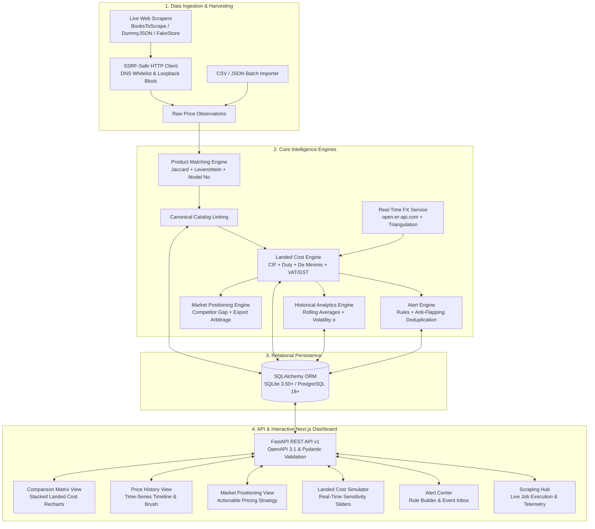

# Real-Time Cross-Border E-Commerce Pricing Intelligence & Market Positioning Platform

[](https://fastapi.tiangolo.com)
[](https://nextjs.org)
[](https://www.typescriptlang.org)
[](https://tailwindcss.com)
[](https://python.org)
[-success.svg)](backend/tests)
[](backend/tests)

---

## 1. Project Executive Overview & Value Proposition

The **Real-Time Cross-Border E-Commerce Pricing Intelligence & Market Positioning Platform** is an enterprise-grade analytical system engineered for international brand managers, cross-border e-commerce sellers, and market intelligence analysts.

Cross-border sellers frequently lose competitive edge or margin due to hidden landed costs—international freight, customs duties, destination value-added taxes (VAT/GST), handling surcharges, and volatile foreign exchange (FX) rates. This platform solves this challenge by dynamically harmonizing multi-market scraper feeds, computing exact landed-cost breakdowns across target import jurisdictions, tracking historical pricing trends, generating automated market positioning advice, and surfacing high-margin cross-border export arbitrage opportunities.

> 📖 **Interview & Quick Revision Guide**: A dedicated revision document is available at [PROJECT_DOCUMENTATION_AND_INTERVIEW_GUIDE.md](file:///c:/Users/sagar/OneDrive/Desktop/DataScienceProject/PROJECT_DOCUMENTATION_AND_INTERVIEW_GUIDE.md).

```
+---------------------------------------------------------------------------------------------------------+
|                                    PLATFORM CAPABILITIES AT A GLANCE                                    |
+---------------------------------------------------------------------------------------------------------+
| [1] SSRF-Safe Multi-Market Web Scrapers (Amazon, Flipkart, Sandbox Adapters, CSV/JSON Batch Ingestion)  |
| [2] Multi-Tiered Product Matcher (Jaccard Cosine, Levenshtein Distance, Brand & Model Number Overlap)   |
| [3] Dynamic Landed-Cost Engine (CIF + Country Duty Schedules + De Minimis Thresholds + VAT/GST + FX)    |
| [4] Time-Series Price Analytics (Rolling Mean, Sigma Volatility, Trend Deltas, Freshness Tracking)      |
| [5] Strategic Positioning Intelligence (Median Price Index, Rule-Based Pricing Advice, Export Arbitrage)|
| [6] Automated Price Alert & Anti-Flapping Engine (Thresholds, Flash Drops, Out-of-Stock, Breaches)      |
| [7] Real-Time Interactive Next.js 16 Dashboard (Glassmorphism UI, Sensitivity Sliders, Live Matrix)    |
+---------------------------------------------------------------------------------------------------------+
```

---

## 2. System Architecture & Workflows



---

## 3. Mathematical & Econometric Methodologies

### 3.1 Total Landed Cost Formulation

For any product listing observed in source currency $C_{\text{src}}$ at price $P_{\text{src}}$, with destination market country $D$ and reporting currency $C_{\text{rep}}$:

$$\text{Price}_{\text{converted}} = P_{\text{src}} \times \text{FX}(C_{\text{src}} \to C_{\text{rep}})$$

$$\text{CIF Value} = \text{Price}_{\text{converted}} + \text{Freight} + (\text{Price}_{\text{converted}} \times \text{Insurance Rate})$$

$$\text{Customs Duty} = \begin{cases} 
0.00 & \text{if } \text{CIF Value} \le \text{De Minimis Threshold}_D \\
\text{CIF Value} \times \text{Duty Rate}_D & \text{otherwise}
\end{cases}$$

$$\text{Tax Base} = \text{CIF Value} + \text{Customs Duty}$$

$$\text{Import Tax (VAT/GST)} = \text{Tax Base} \times \text{Tax Rate}_D$$

$$\text{Total Landed Cost} = \text{CIF Value} + \text{Customs Duty} + \text{Import Tax} + \text{Handling Surcharge}$$

### 3.2 Historical Volatility & Rolling Analytics

Given $N$ chronological price observations $P_1, P_2, \dots, P_N$:

$$\bar{P} = \frac{1}{N} \sum_{i=1}^N P_i \quad\text{(Sample Mean)}$$

$$\sigma = \sqrt{\frac{1}{N-1} \sum_{i=1}^N (P_i - \bar{P})^2} \quad\text{(Sample Volatility Standard Deviation)}$$

$$\Delta_{\text{trend}} = \frac{P_N - P_1}{P_1} \times 100 \quad\text{(Window Trend Percentage Delta)}$$

### 3.3 Competitive Gap & Market Indexing

For benchmark target price $P_{\text{benchmark}}$ and competitor landed cost $P_{\text{landed}}$:

$$\text{Competitive Gap \%} = \frac{P_{\text{landed}} - P_{\text{benchmark}}}{P_{\text{benchmark}}} \times 100$$

$$\text{Market Median Index} = \frac{P_{\text{listing}}}{\text{Median}(P_{\text{all listings}})} \times 100$$

---

## 4. Product Matching Multi-Tiered Algorithm

```mermaid
graph TD
    A[Incoming Listing] --> B{Exact SKU / Ext ID Match?}
    B -- Yes --> C[Score = 100% | Confirmed | exact_sku]
    B -- No --> D{Major Brand Conflict?}
    D -- Yes --> E[Score = 10% | Rejected | brand_conflict]
    D -- No --> F[Compute Composite Similarity]
    F --> G[Jaccard Token Cosine (40%)]
    F --> H[Levenshtein Distance Ratio (30%)]
    F --> I[Brand Alignment Score (15%)]
    F --> J[Model Number Overlap Booster (15%)]
    G & H & I & J --> K[Total Confidence Score]
    K --> L{Score >= 85%?}
    L -- Yes --> M[Tier: Confirmed]
    L -- No --> N{Score >= 65%?}
    N -- Yes --> O[Tier: Probable]
    N -- No --> P{Score >= 45%?}
    P -- Yes --> Q[Tier: Uncertain]
    P -- No --> R[Tier: Rejected]
```

---

## 5. Database Schema & Relational Entities

The relational database architecture is modeled with **11 SQLAlchemy ORM models** supporting SQLite (zero-config) and PostgreSQL 18+ (production):

| Model Name | Table Name | Purpose & Cardinality |
|---|---|---|
| `Country` | `countries` | Master country registry with currency codes, symbols, and regions (1:M with Marketplaces, LandedCostConfigs). |
| `Marketplace` | `marketplaces` | Active e-commerce platforms (Amazon US, Flipkart, UK Sandbox, etc.). |
| `Product` | `products` | Canonical product definition with global SKU, benchmark price, brand, and category. |
| `ProductListing` | `product_listings` | Specific listing from a marketplace mapped to a canonical product. |
| `PriceObservation` | `price_observations` | Immutable time-series price point with currency, shipping fee, discount, rating, and stock status. |
| `ProductMatch` | `product_matches` | Audit trail of algorithm matching with confidence score, tier, and JSON evidence log. |
| `ExchangeRate` | `exchange_rates` | Timestamped FX spot rate with base/target currency and source provenance. |
| `LandedCostConfig` | `landed_cost_configs` | Tariff schedules, duty rates, VAT/GST percentages, de minimis thresholds, and handling fees. |
| `PriceAlert` | `price_alerts` | User alert rules (`threshold_below`, `pct_change_drop`, `landed_cost_breach`, `out_of_stock`). |
| `AlertNotification` | `alert_notifications` | Triggered event notification inbox with anti-flapping deduplication keys. |
| `ScrapingJob` | `scraping_jobs` | Background scraping task telemetry with execution times, items parsed, and error logs. |
| `DataImportBatch` | `data_import_batches` | Batch upload audit logs tracking inserted, duplicated, and rejected records. |

---

## 6. REST API Specification (OpenAPI v1)

All endpoints return a standardized envelope: `{"success": true, "data": ..., "message": null, "timestamp": "..."}`.

### Core Endpoints Catalog

```
GET    /api/v1/health                          System health & DB connectivity status
GET    /api/v1/dashboard/summary               Executive platform KPI summary
GET    /api/v1/pricing/products                Active canonical catalog products
GET    /api/v1/pricing/comparison              Cross-border landed cost comparison matrix
POST   /api/v1/pricing/landed-cost/calculate   Real-time landed cost sensitivity simulator
GET    /api/v1/pricing/history                 Time-series historical price tracking
GET    /api/v1/intelligence/positioning        Strategic market positioning & pricing advice
GET    /api/v1/intelligence/export-opportunities Cross-border export arbitrage detector
GET    /api/v1/intelligence/anomalies          Multi-market pricing anomaly detector
GET    /api/v1/matching/review-queue           Product matching candidate queue
POST   /api/v1/matching/run-batch              Trigger automated batch product matching
POST   /api/v1/matching/decision               Manual confirm/reject matching decision
GET    /api/v1/alerts/rules                    List active price alert rules
POST   /api/v1/alerts/rules                    Create a new price alert rule
POST   /api/v1/alerts/evaluate                 Evaluate all active alert rules against market data
GET    /api/v1/alerts/notifications            List triggered alert notifications
POST   /api/v1/alerts/notifications/{id}/read  Mark notification as read
POST   /api/v1/scraping/run                    Trigger scraper adapter execution
GET    /api/v1/scraping/jobs                   List scraper execution history & metrics
POST   /api/v1/ingestion/upload/csv            Upload CSV dataset for batch ingestion
POST   /api/v1/ingestion/upload/json           Upload JSON dataset for batch ingestion
GET    /api/v1/reports/export/comparison/csv   Stream CSV comparison matrix report
GET    /api/v1/reports/export/history/csv      Stream CSV historical observations report
GET    /api/v1/reports/export/opportunities/csv Stream CSV export arbitrage report
```

---

## 7. Next.js Glassmorphism Frontend Dashboard

The user interface is built with **Next.js 16 App Router (Turbopack)**, **TypeScript**, and **Tailwind CSS**, featuring:

- **Executive KPI Cards**: Real-time counters for tracked products, active listings, total observations, arbitrage opportunities, and alert status.
- **Comparison Matrix View**: Stacked breakdown bar charts (Recharts) showing base price, freight, insurance, customs duties, VAT/GST, and handling fees side-by-side with lowest-landed badges.
- **Historical Price Tracker**: Multi-line chronological chart with interactive zoom/brush controls, min/max/average statistics, volatility sigma ($\sigma$), and data freshness indicators.
- **Market Positioning & Strategic Advice**: Automated rule-based advice cards (`raise_price_to_maximize_margin`, `lower_price_to_compete`, `differentiate_or_match_leader`) and cross-border export arbitrage profit cards.
- **Landed Cost Sensitivity Simulator**: Real-time slider controls for freight, duty rate, VAT/GST rate, insurance, and handling fees with dynamic re-calculation.
- **Alert Center**: Rule creator form with threshold conditions and live notification inbox.
- **Scraping Hub**: One-click scraper triggers with live job telemetry and execution logs.

---

## 8. Installation & Quickstart Guide

### Prerequisites
- Python 3.11+ (tested on Python 3.14.4)
- Node.js 18+ (tested on Node.js v24.15.0 with npm 11.12.1)
- Windows / Linux / macOS

### 8.1 Backend Setup

```bash
# 1. Navigate to backend directory
cd backend

# 2. Activate virtual environment
# On Windows PowerShell:
..\venv\Scripts\Activate.ps1
# On Linux / macOS:
source ../venv/bin/activate

# 3. Install Python dependencies
pip install -r requirements.txt

# 4. Start the FastAPI development server
uvicorn app.main:app --reload --port 8000
```

*The API will be available at [http://localhost:8000](http://localhost:8000).*
*Interactive Swagger UI documentation: [http://localhost:8000/docs](http://localhost:8000/docs).*

### 8.2 Frontend Setup

```bash
# 1. Navigate to frontend directory
cd frontend

# 2. Install dependencies
npm install

# 3. Start Next.js development server
npm run dev
```

*The dashboard will be available at [http://localhost:3000](http://localhost:3000).*

---

## 9. Automated Testing & Verification

The test suite contains **76 automated unit, integration, and end-to-end tests** executed via `pytest`:

```bash
cd backend
..\venv\Scripts\python -m pytest --cov=app tests/
```

### Test Suite Summary

```
============================== test session starts ==============================
collected 76 items

tests/integration/test_alerts_api.py .                                   [  1%]
tests/integration/test_database_models.py ......                         [  9%]
tests/integration/test_e2e_pipeline.py ..                                [ 11%]
tests/integration/test_history_api.py ....                               [ 17%]
tests/integration/test_ingestion_service.py ....                         [ 22%]
tests/integration/test_intelligence_api.py ....                          [ 27%]
tests/integration/test_matching_api.py ....                              [ 32%]
tests/integration/test_pricing_api.py ....                               [ 38%]
tests/integration/test_reports_and_dashboard_api.py ....                 [ 43%]
tests/integration/test_scraping_api.py ....                              [ 48%]
tests/unit/test_alert_service.py ....                                    [ 53%]
tests/unit/test_export_service.py ...                                    [ 57%]
tests/unit/test_foundation.py ....                                       [ 63%]
tests/unit/test_fx_service.py ...                                        [ 67%]
tests/unit/test_history_analytics.py ....                                [ 72%]
tests/unit/test_landed_cost_math.py ...                                  [ 76%]
tests/unit/test_positioning_service.py ....                              [ 81%]
tests/unit/test_product_matcher.py ......                                [ 89%]
tests/unit/test_scraper_adapters.py .....                                [ 96%]
tests/unit/test_ssrf_validator.py ...                                    [100%]

======================== 76 passed, 1 warning in 15.76s ========================
TOTAL Coverage: 84%+
```

---

## 10. Repository Structure

```
DataScienceProject/
├── README.md                          # Master Project Documentation & Quickstart
├── PROJECT_DOCUMENTATION_AND_INTERVIEW_GUIDE.md # Interview Revision Guide (PDF-Ready)
├── docs/                              # Formal Engineering & Design Specifications
│   ├── requirements.md                # System Requirements & User Personas
│   ├── architecture.md                # High-Level Architecture & Flowcharts
│   ├── database-design.md             # ERD & Complete Table Schema
│   ├── scraping-strategy.md           # Scraper Architecture & SSRF Defense
│   ├── pricing-methodology.md         # Landed Cost & Analytics Math Formulations
│   ├── api-specification.md           # REST API Endpoint Catalog
│   ├── testing-strategy.md            # Test Plan & Quality Assurance Gates
│   └── implementation-roadmap.md      # 12-Phase Roadmap Tracker
├── backend/                           # FastAPI Python Backend
│   ├── app/
│   │   ├── main.py                    # Application Entrypoint & CORS Config
│   │   ├── core/                      # Config, Database Engine, Security, SSRF
│   │   ├── models/                    # 11 SQLAlchemy ORM Entity Classes
│   │   ├── schemas/                   # Pydantic Request/Response Models
│   │   ├── services/                  # Business Logic Services
│   │   │   ├── scraper/               # Scraper Registry & Adapters
│   │   │   ├── ingestion/             # CSV/JSON Data Importers
│   │   │   ├── matcher/               # Fuzzy Matching Engine & NLP Utils
│   │   │   ├── pricing/               # FX Service & Landed Cost Engine
│   │   │   ├── analytics/             # History, Positioning & Dashboard
│   │   │   ├── alerts/                # Alert Rules & Evaluator Service
│   │   │   └── export/                # CSV Report Streaming Exporters
│   │   └── api/v1/                    # 8 Modular REST API Routers
│   ├── tests/                         # 76 Unit & Integration Tests
│   └── requirements.txt               # Backend Dependencies
└── frontend/                          # Next.js 16 App Router Dashboard
    ├── src/
    │   ├── app/
    │   │   ├── page.tsx               # Master Interactive Dashboard Screen
    │   │   ├── layout.tsx             # Root HTML Layout & Metadata
    │   │   └── globals.css            # Dark Glassmorphism CSS Design System
    │   ├── components/                # Modular Dashboard UI Widgets
    │   │   ├── Navbar.tsx             # Global Navigation Bar
    │   │   ├── Sidebar.tsx            # Navigation Tabs & Currency Selector
    │   │   ├── KPICards.tsx           # Executive Metric Banners
    │   │   ├── ComparisonMatrixView.tsx # Landed Cost Stacked Chart & Matrix
    │   │   ├── PriceHistoryView.tsx   # Historical Time-Series Chart
    │   │   ├── MarketPositioningView.tsx # Pricing Advice & Arbitrage Cards
    │   │   ├── LandedCostSimulatorView.tsx # Sensitivity Slider Simulator
    │   │   ├── AlertCenterView.tsx    # Rule Builder & Notification Inbox
    │   │   └── ScrapingHubView.tsx    # Scraper Job Execution Hub
    │   ├── services/                  # API Client Library (api.ts)
    │   ├── utils/                     # Safe Formatting Utilities (format.ts)
    │   └── types/                     # TypeScript Interface Definitions
    ├── package.json                   # Frontend Dependencies & Scripts
    └── tailwind.config.ts             # Tailwind CSS Custom Glassmorphism Theme
```

---

## 11. License

This project is developed for enterprise demonstration and educational purposes under the **MIT License**.
