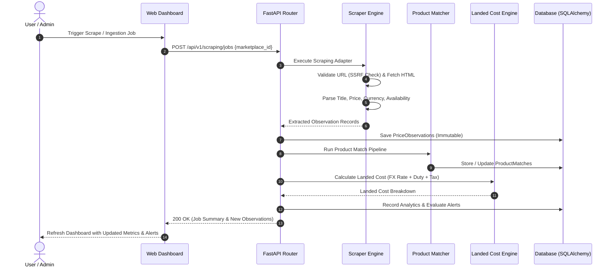

# System Architecture

## 1. High-Level Architecture Overview

The system is designed as a **modular monolith** optimized for performance, explainability, maintainability, and clean separation of concerns. It cleanly decouples data acquisition (scraping & ingestion), normalization & matching, financial computation (currency conversion & landed cost), historical time-series storage, market positioning analytics, and modern interactive visual presentation.

```mermaid
graph TD
    subgraph Frontend ["Frontend Web Application (Next.js / React / TypeScript / Tailwind CSS)"]
        UI_Dash["Overview Dashboard"]
        UI_Comp["Product Comparison"]
        UI_Hist["Price History & Trends"]
        UI_Pos["Market Positioning"]
        UI_Scrape["Scraping Operations"]
        UI_Alerts["Alerts & Reports"]
        UI_Set["Settings & Landed Cost Sim"]
    end

    subgraph API_Gateway ["FastAPI Application Server"]
        Router["FastAPI REST Router (/api/v1)"]
        AuthMiddleware["CORS & Request Middleware"]
        Validator["Pydantic v2 Schemas & SSRF Guard"]
    end

    subgraph Core_Services ["Core Domain Engine Services"]
        IngestService["Data Ingestion & Dataset Importer"]
        ScraperEngine["Scraping Engine & Adapter Registry"]
        MatcherService["Product Matching Engine"]
        FXService["Currency & Exchange Rate Engine"]
        LandedCostService["Landed Cost Calculator"]
        AnalyticsService["Market Positioning & Analytics Engine"]
        AlertService["Alerting & Notification Engine"]
        ExportService["Report & Export Generator"]
    end

    subgraph External_Sources ["External Data Sources"]
        LiveTarget["Live Scraping Sandboxes (BooksToScrape, etc.)"]
        PublicAPI["Public Catalog Feeds (DummyJSON, FakeStore)"]
        FX_API["Traceable FX Provider (open.er-api.com)"]
        DatasetFiles["Imported Datasets (CSV / JSON)"]
    end

    subgraph Storage_Layer ["Persistence Layer"]
        DB[(SQLAlchemy ORM Database: SQLite / PostgreSQL)]
        CatalogTables["Products, Marketplaces, Countries, Listings"]
        ObservationTables["PriceObservations, HistoricalTrends"]
        ConfigTables["LandedCostConfigs, ExchangeRates, Alerts"]
    end

    Frontend -->|REST API Requests (JSON)| API_Gateway
    API_Gateway --> Core_Services
    IngestService --> DatasetFiles
    IngestService --> PublicAPI
    ScraperEngine --> LiveTarget
    FXService --> FX_API
    Core_Services --> Storage_Layer
```

---

## 2. Component Specifications

### 2.1 Frontend Architecture (`frontend/`)
- **Framework**: Next.js 14 / React 18 with TypeScript.
- **Styling**: Tailwind CSS with custom design tokens, dark/light theme support, glassmorphism card surfaces, and accessible semantic palettes.
- **Data Visualization**: Recharts for responsive multi-series price trend charts, competitor price gap bar charts, and landed-cost breakdown stacks.
- **Icons**: Lucide React.
- **State & HTTP**: SWR / TanStack Query pattern for caching, optimistic revalidation, and live polling of running scraping jobs.

### 2.2 Backend API Server (`backend/`)
- **Framework**: FastAPI (Python 3.14 compatible, high-throughput asynchronous execution).
- **Validation**: Pydantic v2 for strict type safety, request validation, and serialized DTOs.
- **Error Handling**: Centralized global exception handler mapping domain errors to structured JSON error responses.
- **Logging**: Structured JSON logging with request tracing, execution latency metrics, and error stack traces.

### 2.3 Data Ingestion & Dataset Importer (`backend/app/services/ingestion/`)
- Ingests external datasets (CSV, JSON) and public APIs (DummyJSON, FakeStore).
- Validates data types, strips malformed characters, normalizes ISO currency codes, and flags duplicate rows.
- Records import provenance (`source_type`, `import_batch_id`, timestamp) and outputs a detailed execution summary (inserted, updated, rejected, duplicate).

### 2.4 Web Scraping Engine (`backend/app/services/scraper/`)
- **Design Pattern**: Strategy Pattern with a base abstract class `BaseScraperAdapter` and registered concrete implementations:
  - `BooksToScrapeAdapter`: Scrapes real product prices, UPCs, and stock from `books.toscrape.com`.
  - `DummyJsonAdapter`: Pulls structured mock/real-world simulated catalog entries.
  - `FakeStoreAdapter`: Extracts apparel and electronics product listings.
  - `GenericHTMLAdapter`: Rule-based CSS/XPath selector extractor for configurable targets.
- **Resilience**: Token bucket rate limiter, randomized delays (1–3s), HTTP keep-alive session management, and exponential backoff retry.
- **SSRF Mitigation**: Custom DNS resolver validator verifying target IP addresses before connecting (rejects private subnet ranges, link-local, loopback, and metadata endpoints).

### 2.5 Product Matching Engine (`backend/app/services/matcher/`)
- **Matching Pipeline**:
  1. **Canonical Identifier Matching**: Match on identical SKU, GTIN, UPC, or ASIN ($\text{Confidence} = 100\%$).
  2. **Token & Text Similarity**: Tokenize and normalize title/brand strings, remove stop words, compute Jaccard and Cosine similarity.
  3. **Fuzzy String Metric**: Levenshtein distance ratio on normalized product titles.
  4. **Attribute Compatibility**: Verify brand, category, and model number alignment.
- **Output**: Match pair with confidence score, matching criteria explanation, and categorization (`confirmed`, `probable`, `uncertain`).

### 2.6 Currency & Landed-Cost Engine (`backend/app/services/pricing/`)
- **Exchange Rate Manager**: Fetches real-time FX rates from `open.er-api.com`, caches them locally with TTL, and falls back to recorded snapshots with explicit staleness flags.
- **Landed Cost Engine**: Implements the international landed cost formula:
  $$\text{Landed Cost} = (P_{\text{orig}} \times R_{\text{fx}}) + \text{Freight} + \text{Insurance} + \text{Duty} + \text{Import Tax} + \text{Handling Fee}$$
- Allows interactive scenario simulation by overriding freight, duty rates, and tax percentages per country.

### 2.7 Historical Price Tracking & Analytics (`backend/app/services/analytics/`)
- Ingests each validated observation, calculates running metrics (min, max, average, 7-day delta %, 30-day volatility).
- Computes competitor price gaps, market median comparisons, and generates algorithmic market positioning recommendations.

### 2.8 Alerting Service (`backend/app/services/alerts/`)
- Evaluates active alert rules upon every price observation update.
- Supports thresholds, percentage movements, and availability triggers.
- State-tracked notification log prevents repeated alerts for steady states.

---

## 3. Data Flow Diagram



---

## 4. Security & Isolation Architecture

1. **SSRF Guard**: Custom HTTP transport layer resolves hostnames and verifies that resolved IP addresses do not belong to:
   - `0.0.0.0/8`, `10.0.0.0/8`, `100.64.0.0/10`, `127.0.0.0/8`
   - `169.254.0.0/16` (Cloud Metadata / Link-Local)
   - `172.16.0.0/12`, `192.168.0.0/16`, `::1`, `fc00::/7`, `fe80::/10`
2. **SQL Injection Defense**: 100% parameterized queries via SQLAlchemy 2.0 ORM expressions.
3. **CORS & Headers**: Strict CORS origin whitelisting, Content-Security-Policy, and X-Content-Type-Options headers.
4. **Credential Isolation**: Zero hardcoded secrets; `.env` configuration managed through Pydantic `BaseSettings`.
