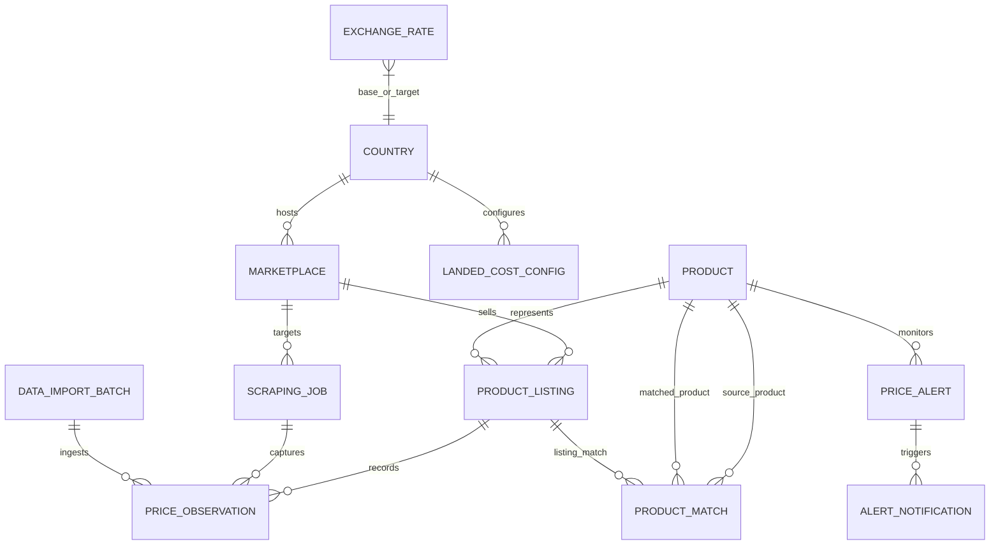

# Database Design & Data Models

## 1. Entity-Relationship Model

---

## 2. Table Schemas & Specifications

### 2.1 `countries`
Stores regional country profiles, primary currency codes, and base trade parameters.

| Column | Type | Constraints | Description |
| :--- | :--- | :--- | :--- |
| `id` | VARCHAR(2) | PRIMARY KEY | ISO 3166-1 alpha-2 code (e.g. `US`, `GB`, `IN`, `DE`, `JP`). |
| `name` | VARCHAR(100) | NOT NULL | Country name (e.g. "United States", "United Kingdom", "India"). |
| `currency_code` | VARCHAR(3) | NOT NULL | Default ISO 4217 currency code (e.g. `USD`, `GBP`, `INR`). |
| `currency_symbol`| VARCHAR(10) | NOT NULL | Currency symbol (e.g. `$`, `£`, `₹`). |
| `region` | VARCHAR(50) | NOT NULL | Geographical region (e.g. "North America", "Europe", "Asia-Pacific"). |
| `is_active` | BOOLEAN | NOT NULL DEFAULT TRUE | Whether the country is active in cross-border tracking. |
| `created_at` | TIMESTAMP | NOT NULL DEFAULT UTC_NOW | Record creation timestamp. |

---

### 2.2 `marketplaces`
Stores supported regional e-commerce channels, platforms, and scrapers.

| Column | Type | Constraints | Description |
| :--- | :--- | :--- | :--- |
| `id` | VARCHAR(50) | PRIMARY KEY | Unique identifier (e.g. `amazon_us`, `amazon_uk`, `flipkart_in`, `books_to_scrape`). |
| `name` | VARCHAR(100) | NOT NULL | Display name (e.g. "Amazon US", "Amazon UK", "Flipkart India"). |
| `country_id` | VARCHAR(2) | FOREIGN KEY -> `countries.id` | Marketplace geographic jurisdiction. |
| `base_url` | VARCHAR(255) | NOT NULL | Root website domain URL. |
| `adapter_name` | VARCHAR(50) | NOT NULL | Associated scraper adapter key. |
| `currency_code` | VARCHAR(3) | NOT NULL | Default listing currency code. |
| `is_active` | BOOLEAN | NOT NULL DEFAULT TRUE | Status flag for scheduled scraping. |
| `created_at` | TIMESTAMP | NOT NULL DEFAULT UTC_NOW | Record creation timestamp. |

---

### 2.3 `products` (Master Canonical Catalog)
Canonical product definitions representing the unified item across all regional listings.

| Column | Type | Constraints | Description |
| :--- | :--- | :--- | :--- |
| `id` | VARCHAR(36) | PRIMARY KEY | UUID v4 canonical product identifier. |
| `sku` | VARCHAR(100) | UNIQUE, NULLABLE | Universal SKU / GTIN / Model code. |
| `title` | VARCHAR(255) | NOT NULL | Canonical product title. |
| `brand` | VARCHAR(100) | NULLABLE | Brand or manufacturer name. |
| `category` | VARCHAR(100) | NOT NULL | Canonical category (e.g. "Electronics", "Books", "Beauty"). |
| `description` | TEXT | NULLABLE | Detailed product overview. |
| `image_url` | VARCHAR(500) | NULLABLE | Representative product image URL. |
| `target_base_price`| DECIMAL(12, 2) | NULLABLE | Baseline manufacturer/retailer target reference price. |
| `base_currency`| VARCHAR(3) | NOT NULL DEFAULT 'USD' | Currency of target base price. |
| `created_at` | TIMESTAMP | NOT NULL DEFAULT UTC_NOW | Creation timestamp. |
| `updated_at` | TIMESTAMP | NOT NULL DEFAULT UTC_NOW | Last modification timestamp. |

**Indexes**:
- `idx_products_sku` on (`sku`)
- `idx_products_category` on (`category`)
- `idx_products_brand` on (`brand`)

---

### 2.4 `product_listings`
Marketplace-specific product listing records linking a canonical product to a live store listing.

| Column | Type | Constraints | Description |
| :--- | :--- | :--- | :--- |
| `id` | VARCHAR(36) | PRIMARY KEY | UUID v4 listing identifier. |
| `product_id` | VARCHAR(36) | FOREIGN KEY -> `products.id`, NULLABLE | Associated master product (NULL if unlinked). |
| `marketplace_id` | VARCHAR(50) | FOREIGN KEY -> `marketplaces.id`, NOT NULL | Marketplace where listing is published. |
| `external_id` | VARCHAR(100) | NOT NULL | Marketplace listing ID (ASIN, Item ID, URL Slug). |
| `listing_title` | VARCHAR(500) | NOT NULL | Title as extracted from marketplace. |
| `listing_url` | VARCHAR(1000) | NOT NULL | Direct product page URL. |
| `currency_code` | VARCHAR(3) | NOT NULL | Listing currency. |
| `seller_name` | VARCHAR(100) | NULLABLE | Name of the third-party merchant or platform seller. |
| `is_active` | BOOLEAN | NOT NULL DEFAULT TRUE | Whether listing is actively tracked. |
| `created_at` | TIMESTAMP | NOT NULL DEFAULT UTC_NOW | Timestamp created. |
| `updated_at` | TIMESTAMP | NOT NULL DEFAULT UTC_NOW | Timestamp last updated. |

**Constraints & Indexes**:
- UNIQUE (`marketplace_id`, `external_id`)
- `idx_listings_product` on (`product_id`)
- `idx_listings_marketplace` on (`marketplace_id`)

---

### 2.5 `price_observations` (Immutable Observation Log)
Contains every discrete price point captured over time. **Observations are immutable and append-only**.

| Column | Type | Constraints | Description |
| :--- | :--- | :--- | :--- |
| `id` | VARCHAR(36) | PRIMARY KEY | UUID v4 observation identifier. |
| `listing_id` | VARCHAR(36) | FOREIGN KEY -> `product_listings.id`, NOT NULL | Associated product listing. |
| `scraping_job_id` | VARCHAR(36) | FOREIGN KEY -> `scraping_jobs.id`, NULLABLE | Associated scraping job (if scraped). |
| `import_batch_id`| VARCHAR(36) | FOREIGN KEY -> `data_import_batches.id`, NULLABLE | Associated dataset batch (if imported). |
| `listed_price` | DECIMAL(12, 2) | NOT NULL | Raw extracted listed price. |
| `currency_code` | VARCHAR(3) | NOT NULL | Currency of listed price. |
| `shipping_price` | DECIMAL(12, 2) | NOT NULL DEFAULT 0.00 | Extracted or estimated shipping charge. |
| `discount_pct` | DECIMAL(5, 2) | NOT NULL DEFAULT 0.00 | Discount percentage, if advertised. |
| `availability_status` | VARCHAR(50) | NOT NULL DEFAULT 'in_stock' | 'in_stock', 'out_of_stock', 'pre_order', 'limited'. |
| `rating` | DECIMAL(3, 2) | NULLABLE | Average customer review rating. |
| `review_count` | INTEGER | NULLABLE | Total number of reviews. |
| `data_provenance` | VARCHAR(50) | NOT NULL | 'live_scrape', 'imported_dataset', 'demo_api', 'synthetic_seed'. |
| `observed_at` | TIMESTAMP | NOT NULL DEFAULT UTC_NOW | Timestamp when price was observed. |

**Indexes**:
- `idx_obs_listing_time` on (`listing_id`, `observed_at` DESC)
- `idx_obs_job` on (`scraping_job_id`)
- `idx_obs_time` on (`observed_at` DESC)

---

### 2.6 `product_matches`
Stores automated and manual matching relationships between canonical products and marketplace listings.

| Column | Type | Constraints | Description |
| :--- | :--- | :--- | :--- |
| `id` | VARCHAR(36) | PRIMARY KEY | UUID v4 match record identifier. |
| `product_id` | VARCHAR(36) | FOREIGN KEY -> `products.id`, NOT NULL | Canonical target product. |
| `listing_id` | VARCHAR(36) | FOREIGN KEY -> `product_listings.id`, NOT NULL | Matched marketplace listing. |
| `confidence_score` | DECIMAL(5, 2) | NOT NULL | Match confidence percentage (0.00 to 100.00). |
| `match_type` | VARCHAR(50) | NOT NULL | 'exact_sku', 'token_cosine', 'fuzzy_levenshtein', 'manual'. |
| `match_evidence` | JSON | NOT NULL | JSON payload detailing similarity components and matching attributes. |
| `status` | VARCHAR(20) | NOT NULL DEFAULT 'confirmed' | 'confirmed', 'probable', 'uncertain', 'rejected'. |
| `created_at` | TIMESTAMP | NOT NULL DEFAULT UTC_NOW | Matching computation timestamp. |

**Constraints**:
- UNIQUE (`product_id`, `listing_id`)
- `idx_matches_status` on (`status`)

---

### 2.7 `exchange_rates`
Historical and live foreign exchange rate cache with source verification.

| Column | Type | Constraints | Description |
| :--- | :--- | :--- | :--- |
| `id` | VARCHAR(36) | PRIMARY KEY | UUID v4 rate identifier. |
| `base_currency` | VARCHAR(3) | NOT NULL | Base currency code (e.g. `USD`). |
| `target_currency`| VARCHAR(3) | NOT NULL | Target currency code (e.g. `EUR`, `GBP`, `INR`). |
| `rate` | DECIMAL(18, 6) | NOT NULL | Multiplier to convert base to target. |
| `source` | VARCHAR(100) | NOT NULL | Traceable source (e.g. `open.er-api.com`). |
| `is_fallback` | BOOLEAN | NOT NULL DEFAULT FALSE | True if fetched from fallback cache due to network fault. |
| `fetched_at` | TIMESTAMP | NOT NULL DEFAULT UTC_NOW | Snapshot timestamp. |

**Indexes**:
- `idx_fx_pair_time` on (`base_currency`, `target_currency`, `fetched_at` DESC)

---

### 2.8 `landed_cost_configs`
Configurable tax, tariff, freight, and insurance parameters per destination country and product category.

| Column | Type | Constraints | Description |
| :--- | :--- | :--- | :--- |
| `id` | VARCHAR(36) | PRIMARY KEY | UUID v4 config identifier. |
| `country_id` | VARCHAR(2) | FOREIGN KEY -> `countries.id`, NOT NULL | Destination country. |
| `category` | VARCHAR(100) | NOT NULL DEFAULT '*' | Product category wildcard or exact name. |
| `customs_duty_rate`| DECIMAL(5, 4) | NOT NULL DEFAULT 0.0500 | Ad valorem customs duty rate (e.g. 0.05 for 5%). |
| `import_tax_rate` | DECIMAL(5, 4) | NOT NULL DEFAULT 0.1000 | VAT / GST / Sales tax rate (e.g. 0.20 for 20% UK VAT). |
| `de_minimis_threshold`| DECIMAL(10, 2) | NOT NULL DEFAULT 0.00 | Threshold below which duty is exempt (in local currency). |
| `default_freight` | DECIMAL(10, 2) | NOT NULL DEFAULT 15.00 | Standard international shipping cost. |
| `insurance_rate` | DECIMAL(5, 4) | NOT NULL DEFAULT 0.0100 | Cargo insurance rate (e.g. 1% of item value). |
| `handling_fee` | DECIMAL(10, 2) | NOT NULL DEFAULT 5.00 | Brokerage / customs clearance handling fee. |
| `updated_at` | TIMESTAMP | NOT NULL DEFAULT UTC_NOW | Last parameter update timestamp. |

---

### 2.9 `price_alerts` & `alert_notifications`

#### `price_alerts`
| Column | Type | Constraints | Description |
| :--- | :--- | :--- | :--- |
| `id` | VARCHAR(36) | PRIMARY KEY | UUID v4 alert rule ID. |
| `product_id` | VARCHAR(36) | FOREIGN KEY -> `products.id`, NOT NULL | Target product monitored. |
| `alert_type` | VARCHAR(50) | NOT NULL | 'threshold_below', 'pct_change_drop', 'landed_cost_breach', 'out_of_stock'. |
| `condition_value`| DECIMAL(12, 2) | NOT NULL | Target numeric threshold (e.g. \$49.99 or 10.0%). |
| `severity` | VARCHAR(20) | NOT NULL DEFAULT 'medium' | 'low', 'medium', 'high', 'critical'. |
| `is_active` | BOOLEAN | NOT NULL DEFAULT TRUE | Whether rule is currently enabled. |
| `created_at` | TIMESTAMP | NOT NULL DEFAULT UTC_NOW | Rule creation timestamp. |

#### `alert_notifications`
| Column | Type | Constraints | Description |
| :--- | :--- | :--- | :--- |
| `id` | VARCHAR(36) | PRIMARY KEY | UUID v4 notification ID. |
| `alert_id` | VARCHAR(36) | FOREIGN KEY -> `price_alerts.id`, NOT NULL | Triggering alert rule. |
| `observation_id` | VARCHAR(36) | FOREIGN KEY -> `price_observations.id`, NOT NULL | Snapshot observation that triggered alert. |
| `message` | TEXT | NOT NULL | Human-readable alert explanation. |
| `evidence_payload`| JSON | NOT NULL | Historical and current price details. |
| `is_acknowledged` | BOOLEAN | NOT NULL DEFAULT FALSE | Whether acknowledged by user. |
| `triggered_at` | TIMESTAMP | NOT NULL DEFAULT UTC_NOW | Notification trigger timestamp. |

---

### 2.10 `scraping_jobs` & `data_import_batches`

#### `scraping_jobs`
| Column | Type | Constraints | Description |
| :--- | :--- | :--- | :--- |
| `id` | VARCHAR(36) | PRIMARY KEY | UUID v4 job ID. |
| `marketplace_id` | VARCHAR(50) | FOREIGN KEY -> `marketplaces.id`, NOT NULL | Target marketplace. |
| `status` | VARCHAR(20) | NOT NULL DEFAULT 'queued' | 'queued', 'running', 'success', 'partial_failure', 'failed'. |
| `items_discovered`| INTEGER | NOT NULL DEFAULT 0 | Count of listing URLs discovered. |
| `items_extracted` | INTEGER | NOT NULL DEFAULT 0 | Count of valid price observations extracted. |
| `error_count` | INTEGER | NOT NULL DEFAULT 0 | Count of errors encountered. |
| `error_log` | TEXT | NULLABLE | Detailed diagnostic error traces. |
| `started_at` | TIMESTAMP | NULLABLE | Job execution start time. |
| `finished_at` | TIMESTAMP | NULLABLE | Job execution finish time. |

#### `data_import_batches`
| Column | Type | Constraints | Description |
| :--- | :--- | :--- | :--- |
| `id` | VARCHAR(36) | PRIMARY KEY | UUID v4 batch ID. |
| `source_name` | VARCHAR(100) | NOT NULL | Name of dataset file or public feed (e.g. `dummyjson_electronics.csv`). |
| `record_count` | INTEGER | NOT NULL | Total rows processed. |
| `inserted_count`| INTEGER | NOT NULL | Successfully created records. |
| `duplicate_count`| INTEGER | NOT NULL | Deduplicated records. |
| `rejected_count` | INTEGER | NOT NULL | Rejected malformed rows. |
| `summary_log` | JSON | NOT NULL | Ingestion execution summary breakdown. |
| `imported_at` | TIMESTAMP | NOT NULL DEFAULT UTC_NOW | Timestamp of import. |

---

## 3. Database Engine & Migration Architecture

- **Engine Support**: Fully standard SQL DDL compatible with SQLite 3 (local standalone zero-dependency execution) and PostgreSQL 14+ (enterprise deployment).
- **ORM & Migrations**: SQLAlchemy 2.0 declarative models managed through Alembic migration scripts.
