# Implementation Roadmap & Phase Milestones

## 1. Roadmap Overview

The project follows a structured, phased implementation workflow. Each phase delivers a functional, tested module that integrates into the monolithic architecture without speculative or unverified code.

```mermaid
gantt
    title Development Roadmap & Milestone Phases
    dateFormat  X
    axisFormat %s
    
    section Foundation & Setup
    Phase 0 - Inspect & Plan        :done, p0, 0, 1
    Phase 1 - Project Foundation    :done, p1, after p0, 1d
    Phase 2 - Database & Models     :done, p2, after p1, 1d
    
    section Core Engines
    Phase 3 - Web Scraping Engine   :done, p3, after p2, 2d
    Phase 4 - Product Matching      :done, p4, after p3, 1d
    Phase 5 - Currency & Landed Cost:done, p5, after p4, 1d
    
    section Analytics & Intelligence
    Phase 6 - Historical Tracking   :done, p6, after p5, 1d
    Phase 7 - Market Positioning    :done, p7, after p6, 1d
    Phase 8 - Alerts & Reports      :done, p8, after p7, 1d
    
    section UI & Integration
    Phase 9 - Frontend Dashboard    :done, p9, after p8, 2d
    Phase 10 - API Integration      :done, p10, after p9, 1d
    Phase 11 - Full Test Suite      :done, p11, after p10, 1d
    Phase 12 - Master Docs & Demo   :done, p12, after p11, 1d
```

---

## 2. Detailed Phase Breakdown

### Phase 0 — Inspect and Plan (Current Phase)
- **Objective**: Inspect workspace, analyze runtimes, discover relevant public datasets, establish system architecture, and produce documentation.
- **Deliverables**: Complete documentation in `docs/` (`requirements.md`, `architecture.md`, `database-design.md`, `scraping-strategy.md`, `pricing-methodology.md`, `api-specification.md`, `testing-strategy.md`, `implementation-roadmap.md`).
- **Approval Gate**: Stop and present architecture and plan for user review.

---

### Phase 1 — Project Foundation
- **Objective**: Establish modular workspace layout, virtual environment, dependencies (`requirements.txt`, `package.json`), environment configuration (`.env.example`), structured logging, and base server boilerplate.
- **Deliverables**: `backend/` FastAPI setup, CORS middleware, centralized exception handler, logging configuration, health check endpoint (`GET /api/v1/health`), and root setup scripts.
- **Verification**: Backend starts and responds `{"status": "healthy"}` on `http://127.0.0.1:8000/api/v1/health`.

---

### Phase 2 — Database and Data Models
- **Objective**: Implement SQLAlchemy 2.0 ORM models, migration scripts (Alembic), relationship mappings, constraints, and seed data.
- **Deliverables**: Declarative models for `Country`, `Marketplace`, `Product`, `ProductListing`, `PriceObservation`, `ProductMatch`, `ExchangeRate`, `LandedCostConfig`, `PriceAlert`, `AlertNotification`, `ScrapingJob`, and `DataImportBatch`.
- **Verification**: Database initialized, migrations run cleanly, relationships and indexes verified.

---

### Phase 3 — Web Scraping & Ingestion Engine
- **Objective**: Build reusable scraping adapter registry, SSRF-safe HTTP client, HTML extraction parsers, dataset importer (CSV/JSON), and sample API connectors (DummyJSON, FakeStore).
- **Deliverables**: `SafeHttpClient`, `BaseScraperAdapter`, `BooksToScrapeAdapter`, `DummyJsonAdapter`, `DataIngestionService`, and scraping job runner.
- **Verification**: Scrape job extracts real product data from BooksToScrape sandbox, ingests sample products into database with full provenance logging.

---

### Phase 4 — Product Matching Engine
- **Objective**: Build the multi-factor product matching engine that pairs cross-marketplace listings with canonical products.
- **Deliverables**: Tokenizer, fuzzy Levenshtein ratio, Jaccard token cosine matcher, confidence grading system (`confirmed`, `probable`, `uncertain`), and match inspection APIs.
- **Verification**: Automated matching matches disparate marketplace listings with confidence scores and explainable criteria.

---

### Phase 5 — Currency and Landed-Cost Engine
- **Objective**: Implement traceable FX conversion with fallback caching and multi-component landed cost calculator.
- **Deliverables**: FX rate service, exchange rate cache table, landed cost computation module (freight, insurance, customs duty, de minimis exemptions, VAT/GST).
- **Verification**: Precise mathematical verification against test fixtures across multiple currency pairs (GBP, USD, EUR, INR).

---

### Phase 6 — Historical Price Tracking
- **Objective**: Append immutable price observations over time and compute rolling analytics (price delta %, min/max/average, volatility).
- **Deliverables**: Observation storage pipeline, historical aggregation queries, stale data detection, and price history timeseries APIs.
- **Verification**: Adding sequential price observations triggers correct historical delta and range calculations without data loss.

---

### Phase 7 — Market Positioning Intelligence
- **Objective**: Compute competitive positioning indices, competitor price gaps, market median comparisons, and actionable recommendations.
- **Deliverables**: Positioning analytics engine, anomaly detector (large discounts/hikes), underpriced opportunity finder.
- **Verification**: Math checks for price gap percentages and market positioning classifications.

---

### Phase 8 — Alerts and Reports
- **Objective**: Implement configurable price alert rule evaluator and export service.
- **Deliverables**: Alert evaluation engine with deduplication state tracking, notification generation, and CSV/JSON export endpoints.
- **Verification**: Trigger conditions fire notifications, steady states produce no duplicates, CSV export downloads cleanly.

---

### Phase 9 — Frontend Dashboard
- **Objective**: Build modern, responsive, aesthetic UI with rich data visualizations.
- **Deliverables**: Next.js / React application with Tailwind CSS, Lucide icons, Recharts visualizations:
  - Overview Dashboard with KPIs and health cards
  - Product Comparison Matrix with landed cost stack
  - Price History interactive timeseries charts
  - Market Positioning & Competitor Gap analysis
  - Scraping Job Management & Live Runner
  - Alerts Center
  - Settings & Interactive Landed Cost Simulator
- **Verification**: Interactive UI renders with live backend data, dynamic filters, and smooth animations.

---

### Phase 10 — Backend API Integration
- **Objective**: Connect all frontend components to live backend endpoints with error handling, loading spinners, and pagination.
- **Deliverables**: API client, SWR/React Query hooks, dynamic forms, live job polling.
- **Verification**: Zero hardcoded frontend values; all charts, tables, and actions interact with real backend database.

---

### Phase 11 — Testing & Quality Assurance
- **Objective**: Comprehensive test suite execution and bug fixes.
- **Deliverables**: Unit tests, integration tests, E2E workflow test, security SSRF test suite, and coverage report.
- **Verification**: All Pytest tests pass cleanly ($100\%$ green).

---

### Phase 12 — Finalization and Live Demo
- **Objective**: Final polish, documentation sync, demo dataset seeding, and demo walkthrough script.
- **Deliverables**: `README.md`, demo script, complete end-to-end workflow walkthrough.
- **Verification**: Complete live demonstration executing the full end-to-end user journey.

---

## 3. Major Technical Risks & Mitigation Strategies

| Risk | Impact | Mitigation Strategy |
| :--- | :--- | :--- |
| **SSRF Vulnerability in Scraper** | High (Internal network exposure) | `SafeHttpClient` pre-resolves DNS and strictly rejects private, loopback, and cloud metadata IP ranges before opening connections. |
| **External FX API Outage** | Medium (Currency conversion failure) | Persistent database caching of latest verified exchange rates with `is_fallback` flag and UI staleness indicators. |
| **Scraping Target HTML Changes** | Medium (Extraction failures) | Strategy adapter pattern isolates parsing logic per target; detailed scraping error logs pinpoint broken selectors immediately. |
| **False Product Matches** | Medium (Misleading price comparisons) | Multi-tier confidence scoring (`confirmed`, `probable`, `uncertain`) with full evidence breakdown and manual override capabilities. |
| **Landed Cost Discrepancies** | Low (Inaccurate estimates) | Modular, documented landed cost formula with configurable duty/tax rates per country and transparent itemized breakdown. |
