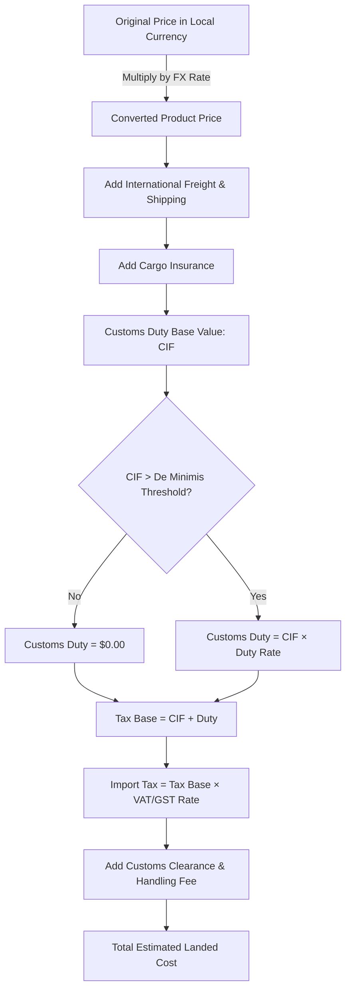

# Pricing Methodology & Landed-Cost Calculations

## 1. Currency Conversion & Exchange Rate Sourcing

Cross-border price comparisons require normalising disparate currencies into a chosen baseline reporting currency (e.g., USD, EUR, GBP, or INR).

### 1.1 Traceable Conversion Formula
Given an original listing price $P_{\text{orig}}$ in source currency $C_{\text{orig}}$ and a destination reporting currency $C_{\text{dest}}$, the converted product price $P_{\text{converted}}$ is:

$$P_{\text{converted}} = P_{\text{orig}} \times R_{\text{fx}}(C_{\text{orig}} \to C_{\text{dest}})$$

Where $R_{\text{fx}}(C_{\text{orig}} \to C_{\text{dest}})$ is the direct exchange rate. If rates are denominated against a base currency (e.g., USD), the cross-rate is:

$$R_{\text{fx}}(C_{\text{orig}} \to C_{\text{dest}}) = \frac{R_{\text{fx}}(\text{USD} \to C_{\text{dest}})}{R_{\text{fx}}(\text{USD} \to C_{\text{orig}})}$$

### 1.2 Rate Hierarchy & Fallback Policy
1. **Live Rate**: Fetched directly from verified public FX endpoint (`https://open.er-api.com/v6/latest/USD`).
2. **Local Cache**: Cached for up to 12 hours in the database (`exchange_rates` table).
3. **Fallback Rate**: If offline or external API unavailable, use the most recent stored snapshot with `is_fallback = true` and a visible staleness warning banner in the dashboard.
4. **Zero Fabrication**: Rates are never artificially fabricated or guessed.

---

## 2. Estimated Landed-Cost Calculation Model

The landed cost represents the total estimated expense of purchasing an item internationally and importing it to the destination market.

### 2.1 Detailed Landed-Cost Formulas

1. **Converted Price**:
   $$P_{\text{dest}} = P_{\text{orig}} \times R_{\text{fx}}$$

2. **CIF Value (Cost, Insurance, Freight)**:
   $$\text{Insurance} = P_{\text{dest}} \times r_{\text{ins}}$$
   $$\text{CIF} = P_{\text{dest}} + \text{Freight} + \text{Insurance}$$

3. **Customs Duty**:
   $$\text{Customs Duty} = \begin{cases} 0.00 & \text{if } \text{CIF} \le \text{Threshold}_{\text{de\_minimis}} \\ \text{CIF} \times r_{\text{duty}} & \text{if } \text{CIF} > \text{Threshold}_{\text{de\_minimis}} \end{cases}$$

4. **Import Taxes (VAT / GST / Sales Tax)**:
   $$\text{Tax Base} = \text{CIF} + \text{Customs Duty}$$
   $$\text{Import Tax} = \text{Tax Base} \times r_{\text{tax}}$$

5. **Total Landed Cost**:
   $$\text{Landed Cost} = \text{CIF} + \text{Customs Duty} + \text{Import Tax} + \text{Handling Fee}$$

---

## 3. Market Positioning & Competitor Intelligence Metrics

### 3.1 Competitor Price Gap Percentage
Calculates the relative pricing differential between our product's landed cost and a competitor listing:

$$\text{Price Gap \%} = \left( \frac{\text{Our Landed Cost} - \text{Competitor Landed Cost}}{\text{Competitor Landed Cost}} \right) \times 100$$

- **Positive ($> 0\%$)**: Our price is higher than the competitor (premium positioning or pricing disadvantage).
- **Negative ($< 0\%$)**: Our price is lower than the competitor (competitive advantage or under-pricing).
- **Zero ($0\%$)**: Price parity.

### 3.2 Market Median & Relative Positioning Index
Given a set of competitor landed prices $\{L_1, L_2, \dots, L_n\}$ for a product category in a market:

$$\text{Market Median} = \text{Median}(L_1, L_2, \dots, L_n)$$
$$\text{Positioning Index} = \frac{\text{Our Landed Cost}}{\text{Market Median}}$$

- $\text{Positioning Index} < 0.90$: Value/Discount segment ($\ge 10\%$ below market median).
- $0.90 \le \text{Positioning Index} \le 1.10$: Core market alignment (within $\pm 10\%$ of median).
- $\text{Positioning Index} > 1.10$: Premium segment ($\ge 10\%$ above market median).

### 3.3 Historical Price Volatility & Trend Delta
$$\Delta P_{7d} = \left( \frac{P_{\text{now}} - P_{7d\text{ ago}}}{P_{7d\text{ ago}}} \right) \times 100$$
$$\sigma = \sqrt{\frac{1}{N-1} \sum_{i=1}^N (P_i - \bar{P})^2}$$

---

## 4. Handling Missing or Incomplete Data

- If shipping or tariff rates are unknown for a country, the engine displays an **Incomplete Estimate** indicator with itemized available fields, rather than substituting false \$0.00 duties.
- Missing observations are never filled with \$0.00 prices, preventing severe skew in trend analytics.
