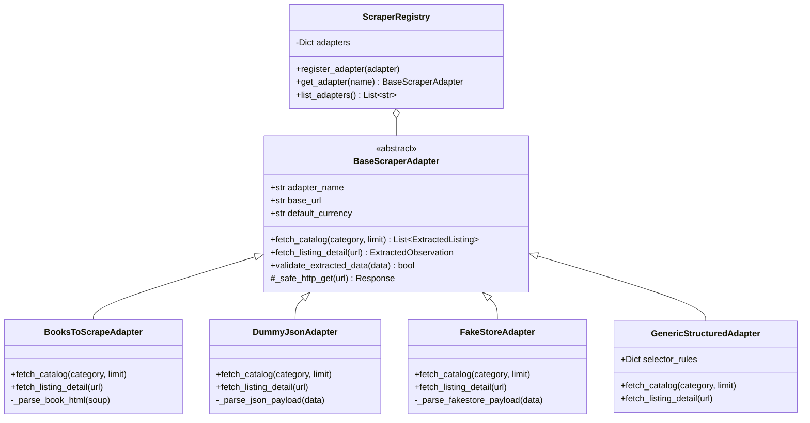
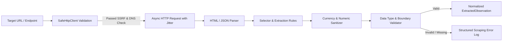
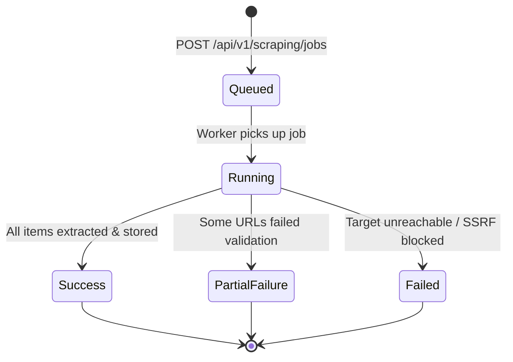

# Web Scraping Strategy & Adapter Architecture

## 1. Core Principles & Responsible Scraping

The web scraping engine is engineered with strict adherence to data integrity, system security, and ethical web scraping standards:

1. **Permitted Targets & Sandboxes**: We scrape explicitly permitted e-commerce sandboxes (e.g., `books.toscrape.com`), open product API endpoints (DummyJSON, FakeStore), and structured merchant catalogs with public pricing.
2. **Zero Access-Control Bypass**: We never bypass CAPTCHAs, paywalls, anti-bot mechanisms, or login requirements.
3. **No Private/Personal Data**: Only public product pricing, product titles, categories, availability statuses, and manufacturer specifications are ingested.
4. **Honest Provenance & Transparency**: Every observation is stamped with its exact origin (`data_provenance = 'live_scrape' | 'imported_dataset' | 'demo_api' | 'synthetic_seed'`). If an extraction fails, a distinct error state is recorded rather than fabricating synthetic data.
5. **Rate Limiting & Politeness**: Scraper requests are throttled using token-bucket rate limits and randomized jittered delays ($1.0 - 2.5\text{ s}$) to prevent target server strain.

---

## 2. Adapter Pattern & Class Hierarchy

The scraping architecture implements the **Strategy Pattern** with an extensible adapter registry:

---

## 3. SSRF & Security Defense (`SafeHttpClient`)

To eliminate Server-Side Request Forgery (SSRF) vulnerabilities, all network operations flow through `SafeHttpClient`:

1. **Protocol Restriction**: Only `http://` and `https://` schemes are permitted. File (`file://`), FTP (`ftp://`), Gopher, and custom schemas are blocked.
2. **Port Restriction**: Only standard web ports `80` and `443` are allowed.
3. **Pre-flight DNS IP Validation**:
   - Hostnames are resolved to IP addresses before initiating a socket connection.
   - Any IP resolving to private or reserved subnets is immediately rejected:
     - `127.0.0.0/8` (Loopback)
     - `10.0.0.0/8`, `172.16.0.0/12`, `192.168.0.0/16` (RFC 1918 Private subnets)
     - `169.254.0.0/16` (Link-Local & Cloud Metadata e.g. AWS/GCP `169.254.169.254`)
     - `0.0.0.0/8`, `100.64.0.0/10`, `198.18.0.0/15`, `::1`, `fc00::/7`, `fe80::/10`
4. **Redirect Guard**: Redirects are followed manually, with every intermediary redirect URL re-validated against the SSRF filter.
5. **Response Limits**: Payload size is capped at 10 MB to prevent memory-exhaustion DoS attacks.

---

## 4. Extraction & Normalization Pipeline

### Extraction Steps:
1. **Title Extraction**: Clean whitespace, normalize unicode entities, strip marketing prefixes.
2. **Price Parsing**: Extract raw string (e.g. `"£51.77"`, `"$1,299.00"`, `"₹49,999.00"`), identify currency symbol/ISO code, and parse into standard `Decimal` representation.
3. **Availability Parsing**: Map textual indicators (`"In stock (19 available)"`, `"Out of stock"`, `"Pre-order"`) to normalized enum states (`in_stock`, `out_of_stock`, `pre_order`).
4. **Identifier Extraction**: Locate UPC, SKU, ISBN, or ASIN in breadcrumbs, table cells, or metadata tags.
5. **Validation Gate**: Verify that `price > 0`, `title` is non-empty, and `currency_code` is a valid 3-letter ISO code.

---

## 5. Scraping Job Execution & Lifecycle

- **Execution Telemetry**: Job status, discovered item count, successfully extracted count, error count, and timestamp duration are tracked in `scraping_jobs`.
- **Observation Linking**: Each successfully parsed record is written to `price_observations` with a foreign key to the `scraping_job_id`.
