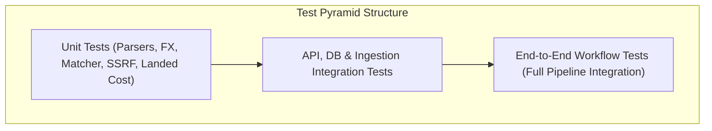

# Testing Strategy & Quality Assurance Plan

## 1. Quality Assurance Philosophy

To ensure absolute reliability, mathematical correctness, and system stability, the testing framework enforces a rigorous test pyramid combining **deterministic unit tests**, **isolated integration tests**, and **end-to-end workflow verification**.



---

## 2. Test Suites & Coverage Scope

### 2.1 Unit Tests (`backend/tests/unit/`)

| Test Module | Coverage & Invariants Verified |
| :--- | :--- |
| `test_ssrf_validator.py` | Validates `SafeHttpClient` against SSRF attack vectors: rejects `127.0.0.1`, `10.0.0.1`, `172.16.0.1`, `192.168.1.1`, `169.254.169.254` (cloud metadata), `::1`, `file:///`, and unapproved ports. |
| `test_html_parsers.py` | Tests extraction of prices (`£51.77`, `$1,299.00`, `₹49,999`), availability badges, titles, and UPCs across static HTML fixtures. |
| `test_product_matcher.py` | Validates exact SKU/GTIN matching ($100\%$), fuzzy token matching, stopword stripping, and confidence threshold grading (`confirmed`, `probable`, `uncertain`). |
| `test_landed_cost_math.py` | Mathematically verifies landed cost, customs duty, de minimis exemptions, VAT calculations, and competitor price gap formulas across edge cases. |
| `test_fx_converter.py` | Tests live rate retrieval, 12-hour caching TTL, cross-currency rate inversion, and fallback mode with `is_fallback` indicator. |
| `test_alert_rules.py` | Tests alert threshold triggers, percentage drop rules, out-of-stock transitions, and notification deduplication. |

---

### 2.2 Integration Tests (`backend/tests/integration/`)

| Test Module | Coverage & Invariants Verified |
| :--- | :--- |
| `test_db_models.py` | Verifies table creation, foreign key constraints, cascading behaviors, uniqueness constraints (`marketplace_id` + `external_id`), and observation immutability. |
| `test_api_products.py` | Verifies `GET /api/v1/products`, `POST /api/v1/products`, query filtering, and pagination schemas. |
| `test_api_pricing.py` | Verifies `GET /api/v1/pricing/comparison` and landed-cost calculation endpoints with mocked FX rates. |
| `test_ingestion_pipeline.py`| Validates CSV and JSON importers against valid rows, missing columns, invalid numeric prices, and duplicate detection. |
| `test_scraping_runner.py`| Executes mock adapter runs, verifying job status transitions (`queued` -> `running` -> `success`), observation persistence, and error logging. |

---

### 2.3 End-to-End Workflow Verification (`backend/tests/e2e/`)

Validates the full business lifecycle:
1. Initialize canonical products catalog.
2. Ingest external market observations (DummyJSON / CSV dataset).
3. Trigger live scraping job against `books.toscrape.com`.
4. Run cross-marketplace matching engine.
5. Compute real-time cross-border landed cost matrix.
6. Evaluate and fire price alerts.
7. Fetch aggregated dashboard summary and verify JSON export payload.

---

## 3. Test Execution & Automation Commands

### Backend Tests:
```powershell
# Run full Pytest suite with code coverage
pytest -v --cov=app tests/

# Run specific unit test suite
pytest -v tests/unit/test_landed_cost_math.py
pytest -v tests/unit/test_ssrf_validator.py
```

### Frontend Tests & Type Checking:
```powershell
# TypeScript type check
npm run type-check

# Run frontend tests
npm run test
```
